
<a href="README.md">English</a> · <a href="README.zh-CN.md">中文</a> · <b>日本語</b>

<picture><source media="(prefers-color-scheme: dark)" srcset="assets/hero-ja-dark.svg" />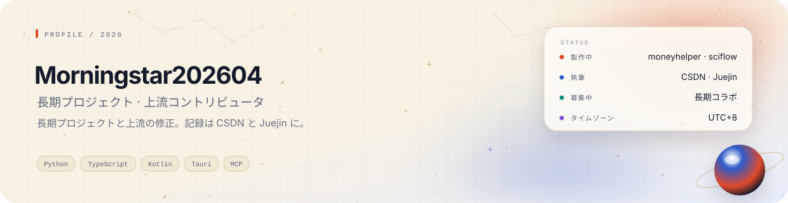</picture>

<picture><source media="(prefers-color-scheme: dark)" srcset="assets/starchart-ja-dark.svg" /></picture>

ゆっくり回る星図 · 一周一分

## 01 · いま

- **個人リポジトリ** — 27 件 · 個人名前空間、fork を除く
- **外部 PR** — 6 件：マージ 3、オープン 2、クローズ 1
- **配信** — CSDN 長文アーカイブ、Juejin・知乎・博客园 は自動運用

## 02 · 外部 PR

6 件 · マージ済み 3 · オープン 2 · クローズ 1 · +48353/−45133 · 180 ファイル · 1 コメント

マージ済み 3 件 · 平均 0 日 · 最速 0 日

- [badhope/CodePocket#36](https://github.com/badhope/CodePocket/pull/36) — feat(0.0.29): ANSI 终端模拟器（本地 xterm.js） · **オープン** · 提出 2026-11-24 · +775/−152 · 20 ファイル · 0 コメント
- [badhope/CodePocket#33](https://github.com/badhope/CodePocket/pull/33) — 0.0.26：正式签名、x86_64 双 ABI、终端与只读子 Agent · **クローズ** · 提出 2026-11-23 · +1862/−139 · 113 ファイル · 1 コメント
- [badhope/CodePocket#32](https://github.com/badhope/CodePocket/pull/32) — feat(0.0.25): Agent 计划模式 + 上下文预算 + 多 Provider / MCP / 终端补齐 · **オープン** · 提出 2026-11-23 · +1055/−76 · 28 ファイル · 0 コメント
- [Nailong-Studio/NaiLoong-Universe#22](https://github.com/Nailong-Studio/NaiLoong-Universe/pull/22) — feat(v18.7.5): 路由双幕转场与响应式动效 · **マージ済み** · マージ 2026-11-20 · +43933/−44398 · 7 ファイル · 0 コメント
- [Nailong-Studio/NaiLoong-Universe#21](https://github.com/Nailong-Studio/NaiLoong-Universe/pull/21) — v18.7.4 · 严格调试：按钮点击、切页滚动、字体对比与八厅罗盘 · **マージ済み** · マージ 2026-11-20 · +615/−365 · 8 ファイル · 0 コメント
- [Nailong-Studio/NaiLoong-Universe#3](https://github.com/Nailong-Studio/NaiLoong-Universe/pull/3) — feat(sfx): 趣味音效——喂到哈哈大笑，被吃噶就塞（v17.6） · **マージ済み** · マージ 2026-10-17 · +113/−3 · 4 ファイル · 0 コメント

PR スナップショット 2026-11-24 · GitHub Search / pulls API

## 03 · 代表プロジェクト

<a href="https://github.com/Morningstar202604/workbench"><picture><source media="(prefers-color-scheme: dark)" srcset="assets/project-0-ja-dark.svg" />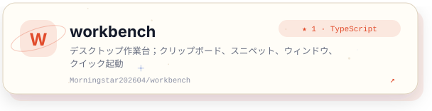</picture></a> <a href="https://github.com/Morningstar202604/creator-studio"><picture><source media="(prefers-color-scheme: dark)" srcset="assets/project-1-ja-dark.svg" />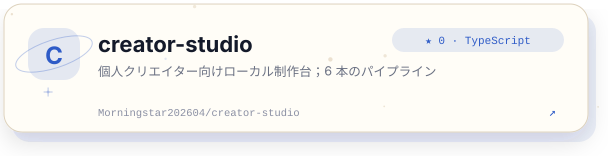</picture></a>

<a href="https://github.com/Morningstar202604/digilegacy"><picture><source media="(prefers-color-scheme: dark)" srcset="assets/project-2-ja-dark.svg" />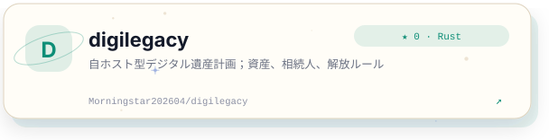</picture></a> <a href="https://github.com/Morningstar202604/harbor"><picture><source media="(prefers-color-scheme: dark)" srcset="assets/project-3-ja-dark.svg" />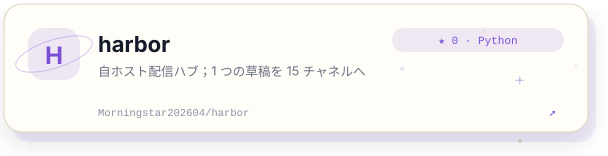</picture></a>

<a href="https://github.com/Morningstar202604/moneyhelper"><picture><source media="(prefers-color-scheme: dark)" srcset="assets/project-4-ja-dark.svg" /></picture></a> <a href="https://github.com/Morningstar202604/sciflow"><picture><source media="(prefers-color-scheme: dark)" srcset="assets/project-5-ja-dark.svg" />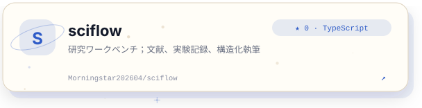</picture></a>

その他のプロジェクト: [world-walker](https://github.com/Morningstar202604/world-walker) · [spark](https://github.com/Morningstar202604/spark)

## 04 · 数字

<picture><source media="(prefers-color-scheme: dark)" srcset="assets/numbers-ja-dark.svg" />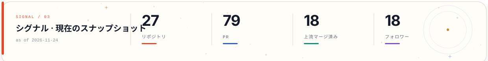</picture>

## 05 · コントリビューション

<picture><source media="(prefers-color-scheme: dark)" srcset="assets/contrib-ja-dark.svg" />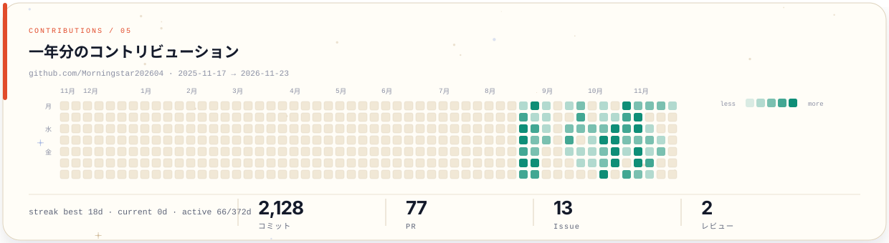</picture>

日々の寄与は GitHub GraphQL の正確なスナップショット · 毎週更新

## 06 · 言語構成

<picture><source media="(prefers-color-scheme: dark)" srcset="assets/langs-ja-dark.svg" />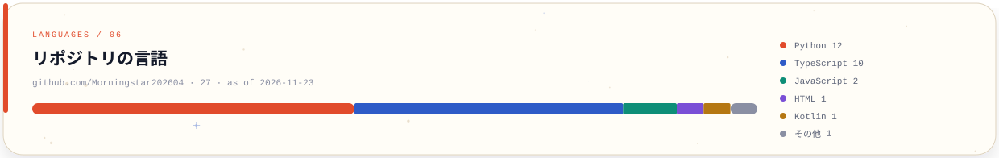</picture>

## 07 · 配信ライン

<a href="https://blog.csdn.net/weixin_56622231"><picture><source media="(prefers-color-scheme: dark)" srcset="assets/channel-csdn-ja-dark.svg" />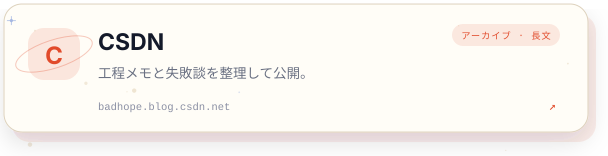</picture></a> <a href="https://juejin.cn/user/2350111542479753/posts"><picture><source media="(prefers-color-scheme: dark)" srcset="assets/channel-juejin-ja-dark.svg" /></picture></a>

<a href="https://www.zhihu.com/people/e7c851hd"><picture><source media="(prefers-color-scheme: dark)" srcset="assets/channel-zhihu-ja-dark.svg" /></picture></a> <a href="https://www.cnblogs.com/badhope"><picture><source media="(prefers-color-scheme: dark)" srcset="assets/channel-cnblogs-ja-dark.svg" /></picture></a>

四つの配信アカウント。CSDN は手動アーカイブ、Juejin・知乎・博客园 は自動化ラインで運用。

CSDN 最新

- 2026-11-04 — [把 AI Agent 接进业务系统，我踩了 3 个挺蠢的坑](https://blog.csdn.net/weixin_56622231/article/details/170051167)
- 2026-10-18 — [Gemini 4 Argon 全面开放：谷歌憋了半年的旗舰大招，到底行不行？](https://blog.csdn.net/weixin_56622231/article/details/168251657)

<a href="https://blog.csdn.net/weixin_56622231">CSDN の全記事 →</a>

One source, five profiles · numbers from a local snapshot

すべてのリポジトリ: [github.com/Morningstar202604](https://github.com/Morningstar202604)
