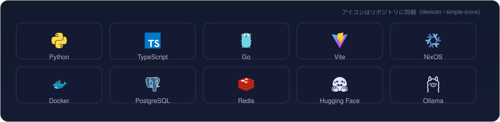

[English](README.md) | [中文](README.zh-CN.md) | [日本語](README.ja.md)

  <picture>
  <source type="image/png" srcset="./assets/png/hero.png" />
  
  </picture>

<i>星を観て、コードを舟に。</i>

First, solve the problem. Then, write the code. — John Johnson

<table border="0">
<tr>
<td valign="top" width="58%">

### について

長期プロジェクトの拠点 — 小説エンジン、決済収単、P2P ネットワーキング。ドキュメント優先・監査優先で育てています。ohmyzsh・tldr・icalendar・NUR などにマージ実績あり。

</td>
<td valign="top" width="42%">

### 近況

- Novel Engine の一貫性監査を反復改良
- KeBaiPay の照合モジュール
- 上流 PR をレビュー中 — ohmyzsh・moto・PDFMathTranslate

</td>
</tr>
</table>

## 道具箱

  

## 主な作品

| プロジェクト | スター | 更新日 |
| --- | --- | --- |
| [workbench — Workbench - a local-first desktop workbench (Tauri 2 +…](https://github.com/Morningstar202604/workbench) | 1 | 2026-10-24 |
| [aquapilot — AI-operated wastewater treatment plant simulator — topo…](https://github.com/Morningstar202604/aquapilot) | 0 | 2026-10-24 |
| [campushub — CampusHub — 校园服务平台](https://github.com/Morningstar202604/campushub) | 0 | 2026-10-24 |
| [creator-studio — 稿台 Creator Studio: 本地优先的创作者 AI 制片台（选题→资料→脚本→分镜→包装→…](https://github.com/Morningstar202604/creator-studio) | 0 | 2026-10-24 |
| [digilegacy — DigiLegacy 归零 — open-source, local-first digital legac…](https://github.com/Morningstar202604/digilegacy) | 0 | 2026-10-24 |
| [Flow — Flow · AI 原生跨境出口电商平台｜买家商城 + 卖家 AI 工作台，5 个真实 LLM Agent、人工审批式运…](https://github.com/Morningstar202604/Flow) | 0 | 2026-10-24 |

全公開リポジトリ： [github.com/Morningstar202604](https://github.com/Morningstar202604)

## 数字で見る

  
  
  

  
  

## ピン留め作品

  
  
  

## コントリビューション

  <picture>
  <source media="(prefers-color-scheme: dark)" srcset="./assets/github-contribution-grid-snake-dark.svg" />
  
  </picture>

## オープンソース

**上流マージ済み**
- [ohmyzsh/ohmyzsh](https://github.com/ohmyzsh/ohmyzsh) — [#14006](https://github.com/ohmyzsh/ohmyzsh/pull/14006) · [#14021](https://github.com/ohmyzsh/ohmyzsh/pull/14021) · [#14027](https://github.com/ohmyzsh/ohmyzsh/pull/14027) — git locale · pipenv activation · aws stderr
- [tldr-pages/tldr](https://github.com/tldr-pages/tldr) — [#23780](https://github.com/tldr-pages/tldr/pull/23780) — doctl pages
- [collective/icalendar](https://github.com/collective/icalendar) — [#1731](https://github.com/collective/icalendar/pull/1731) · [#1750](https://github.com/collective/icalendar/pull/1750) · [#1751](https://github.com/collective/icalendar/pull/1751) — public exports · deprecations · TYPE_CHECKING
- [nix-community/NUR](https://github.com/nix-community/NUR) — [#1220](https://github.com/nix-community/NUR/pull/1220) — SSL errors treated as transient
- [jaychouchannel/claude-tool-agent](https://github.com/jaychouchannel/claude-tool-agent) — [#30](https://github.com/jaychouchannel/claude-tool-agent/pull/30) · [#31](https://github.com/jaychouchannel/claude-tool-agent/pull/31) · [#33](https://github.com/jaychouchannel/claude-tool-agent/pull/33) · [#34](https://github.com/jaychouchannel/claude-tool-agent/pull/34) · [#35](https://github.com/jaychouchannel/claude-tool-agent/pull/35) — mention parsing · markdown safety
- [Hydrooxzgen/EnderBridge](https://github.com/Hydrooxzgen/EnderBridge) — [#12](https://github.com/Hydrooxzgen/EnderBridge/pull/12) — docs: Message mod
- [deepset-ai/haystack](https://github.com/deepset-ai/haystack) — [#13011](https://github.com/deepset-ai/haystack/pull/13011) — docs: merge_super_component_pipelines

**レビュー中**
- [ohmyzsh/ohmyzsh](https://github.com/ohmyzsh/ohmyzsh) — [#14140](https://github.com/ohmyzsh/ohmyzsh/pull/14140) · [#14141](https://github.com/ohmyzsh/ohmyzsh/pull/14141) · [#14148](https://github.com/ohmyzsh/ohmyzsh/pull/14148) · [#14149](https://github.com/ohmyzsh/ohmyzsh/pull/14149) — diagnose locale · vi-mode · extract · dirhistory
- [funstory-ai/BabelDOC](https://github.com/funstory-ai/BabelDOC) — [#621](https://github.com/funstory-ai/BabelDOC/pull/621) · [#623](https://github.com/funstory-ai/BabelDOC/pull/623) — translator guards
- [PDFMathTranslate/PDFMathTranslate](https://github.com/PDFMathTranslate/PDFMathTranslate) — [#1202](https://github.com/PDFMathTranslate/PDFMathTranslate/pull/1202) · [#1203](https://github.com/PDFMathTranslate/PDFMathTranslate/pull/1203) · [#1206](https://github.com/PDFMathTranslate/PDFMathTranslate/pull/1206) — qwen-mt · zhipu errors · line splitting
- [getmoto/moto](https://github.com/getmoto/moto) — [#10287](https://github.com/getmoto/moto/pull/10287) — EC2 MaxCount

## 執筆

| 日付 | 記事 |
|---|---|
| 2026-10-18 | [Gemini 4 Argon 全面开放：谷歌憋了半年的旗舰大招，到底行不行？](https://blog.csdn.net/weixin_56622231/article/details/168251657) |
| 2026-10-16 | [MCP 落地一年，我总结了 6 个没人告诉你的工程真相](https://zhuanlan.zhihu.com/p/2094232145015453253) |
| 2026-10-16 | [本地优先 AI：当所有人都在上云，我为什么把 AI 装回自己电脑](https://zhuanlan.zhihu.com/p/2094233605513991576) |
| 2026-10-16 | [AI Agent 上线前必须过的 5 道关：一个真实项目的工程手记](https://zhuanlan.zhihu.com/p/2094218858789856836) |
| 2026-09-27 | [Playwright 多平台分发：8 个踩坑与合规门禁](https://blog.csdn.net/weixin_56622231/article/details/166698802) |

同時掲載  <a href="https://blog.csdn.net/weixin_56622231">CSDN</a> ·  <a href="https://juejin.cn/user/2350111542479753">Juejin</a> ·  <a href="https://www.zhihu.com/people/e7c851hd">Zhihu</a>

## ほかの場所

> 同一人物の5つの拠点 — これらのアカウントは同じ人のミラーです。

| | プラットフォーム | アカウント | 役割 |
|---|---|---|---|
|  | GitHub | **[X33834](https://github.com/X33834)** | 上流 OSS · ツールと作品 |
|  | GitHub | **[Morningstar202604](https://github.com/Morningstar202604)** | ポートフォリオ · 長期プロジェクト ◆ *現在地* |
|  | GitHub | **[badhope](https://github.com/badhope)** | プロフィール · ツール小屋 |
|  | GitCode | **[badhope](https://gitcode.com/badhope)** | モバイル開発 · オフラインツール |
|  | Gitee | **[badhope](https://gitee.com/badhope)** | ミラー · ミニアプリ |

  

© Morningstar202604

