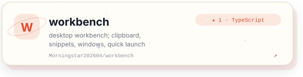
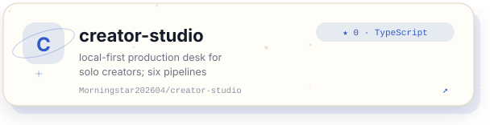
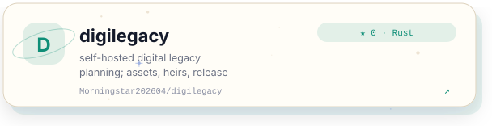
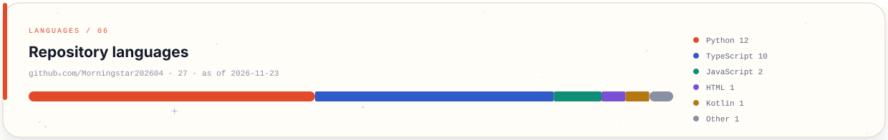
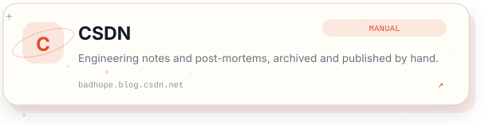
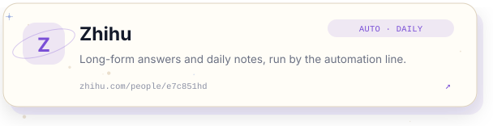
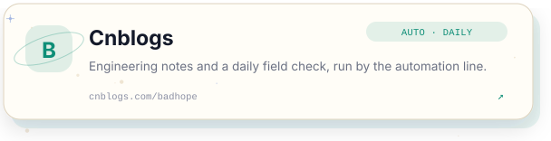

<b>English</b> · <a href="README.zh-CN.md">中文</a> · <a href="README.ja.md">日本語</a>

<picture><source media="(prefers-color-scheme: dark)" srcset="assets/hero-en-dark.svg" /></picture>

<picture><source media="(prefers-color-scheme: dark)" srcset="assets/starchart-en-dark.svg" /></picture>

A slow sky · one turn every minute

## 01 · Now

- **Personal repositories** — 27 · personal namespace, forks excluded
- **Upstream pull requests** — 6 selected: 3 merged, 2 open, 1 closed
- **Publishing** — CSDN archive; Juejin, Zhihu and Cnblogs automation

## 02 · Upstream pull requests

6 selected · 3 merged · 2 open · 1 closed · +48353/−45133 · 180 files · 1 comments

3 merged in 0d on average · fastest 0d

- [badhope/CodePocket#36](https://github.com/badhope/CodePocket/pull/36) — feat(0.0.29): ANSI 终端模拟器（本地 xterm.js） · **open** · opened 2026-11-24 · +775/−152 · 20 files · 0 comments
- [badhope/CodePocket#33](https://github.com/badhope/CodePocket/pull/33) — 0.0.26：正式签名、x86_64 双 ABI、终端与只读子 Agent · **closed** · opened 2026-11-23 · +1862/−139 · 113 files · 1 comment
- [badhope/CodePocket#32](https://github.com/badhope/CodePocket/pull/32) — feat(0.0.25): Agent 计划模式 + 上下文预算 + 多 Provider / MCP / 终端补齐 · **open** · opened 2026-11-23 · +1055/−76 · 28 files · 0 comments
- [Nailong-Studio/NaiLoong-Universe#22](https://github.com/Nailong-Studio/NaiLoong-Universe/pull/22) — feat(v18.7.5): 路由双幕转场与响应式动效 · **merged** · merged 2026-11-20 · +43933/−44398 · 7 files · 0 comments
- [Nailong-Studio/NaiLoong-Universe#21](https://github.com/Nailong-Studio/NaiLoong-Universe/pull/21) — v18.7.4 · 严格调试：按钮点击、切页滚动、字体对比与八厅罗盘 · **merged** · merged 2026-11-20 · +615/−365 · 8 files · 0 comments
- [Nailong-Studio/NaiLoong-Universe#3](https://github.com/Nailong-Studio/NaiLoong-Universe/pull/3) — feat(sfx): 趣味音效——喂到哈哈大笑，被吃噶就塞（v17.6） · **merged** · merged 2026-10-17 · +113/−3 · 4 files · 0 comments

PR snapshot 2026-11-24 · GitHub Search / pulls API

## 03 · Featured projects

<a href="https://github.com/Morningstar202604/workbench"><picture><source media="(prefers-color-scheme: dark)" srcset="assets/project-0-en-dark.svg" /></picture></a> <a href="https://github.com/Morningstar202604/creator-studio"><picture><source media="(prefers-color-scheme: dark)" srcset="assets/project-1-en-dark.svg" /></picture></a>

<a href="https://github.com/Morningstar202604/digilegacy"><picture><source media="(prefers-color-scheme: dark)" srcset="assets/project-2-en-dark.svg" /></picture></a> <a href="https://github.com/Morningstar202604/harbor"><picture><source media="(prefers-color-scheme: dark)" srcset="assets/project-3-en-dark.svg" /></picture></a>

<a href="https://github.com/Morningstar202604/moneyhelper"><picture><source media="(prefers-color-scheme: dark)" srcset="assets/project-4-en-dark.svg" /></picture></a> <a href="https://github.com/Morningstar202604/sciflow"><picture><source media="(prefers-color-scheme: dark)" srcset="assets/project-5-en-dark.svg" /></picture></a>

More projects: [world-walker](https://github.com/Morningstar202604/world-walker) · [spark](https://github.com/Morningstar202604/spark)

## 04 · Numbers

<picture><source media="(prefers-color-scheme: dark)" srcset="assets/numbers-en-dark.svg" /></picture>

## 05 · Contribution calendar

<picture><source media="(prefers-color-scheme: dark)" srcset="assets/contrib-en-dark.svg" /></picture>

Exact daily contributions from the GitHub GraphQL snapshot · refreshed weekly

## 06 · Languages

<picture><source media="(prefers-color-scheme: dark)" srcset="assets/langs-en-dark.svg" /></picture>

## 07 · Publishing line

<a href="https://blog.csdn.net/weixin_56622231"><picture><source media="(prefers-color-scheme: dark)" srcset="assets/channel-csdn-en-dark.svg" /></picture></a> <a href="https://juejin.cn/user/2350111542479753/posts"><picture><source media="(prefers-color-scheme: dark)" srcset="assets/channel-juejin-en-dark.svg" /></picture></a>

<a href="https://www.zhihu.com/people/e7c851hd"><picture><source media="(prefers-color-scheme: dark)" srcset="assets/channel-zhihu-en-dark.svg" /></picture></a> <a href="https://www.cnblogs.com/badhope"><picture><source media="(prefers-color-scheme: dark)" srcset="assets/channel-cnblogs-en-dark.svg" /></picture></a>

Four publishing accounts: CSDN is archived by hand; Juejin, Zhihu and Cnblogs run on the automation line.

Latest on CSDN

- 2026-11-04 — [把 AI Agent 接进业务系统，我踩了 3 个挺蠢的坑](https://blog.csdn.net/weixin_56622231/article/details/170051167)
- 2026-10-18 — [Gemini 4 Argon 全面开放：谷歌憋了半年的旗舰大招，到底行不行？](https://blog.csdn.net/weixin_56622231/article/details/168251657)

<a href="https://blog.csdn.net/weixin_56622231">All posts on CSDN →</a>

One source, five profiles · numbers from a local snapshot

All public repositories: [github.com/Morningstar202604](https://github.com/Morningstar202604)
