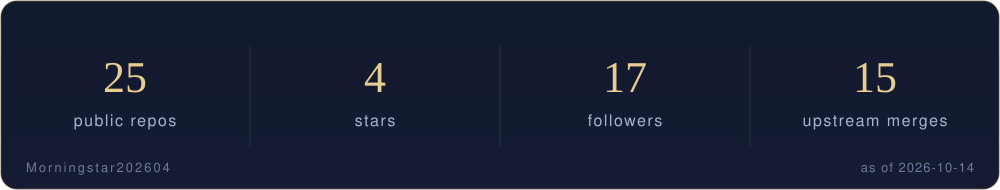

[English](README.md) | [中文](README.zh-CN.md) | [日本語](README.ja.md)

  

<i>Code under the stars, ship with the dawn.</i>

## About

Long-horizon projects live here — a novel-writing engine, a compliant payments intake, P2P networking. Engineering completeness first: docs before code, audits before merges. Patches already merged upstream at ohmyzsh, tldr, icalendar, NUR and more.

### Now

- Iterating the rule-based consistency audit in Novel Engine
- Reconciliation module for KeBaiPay
- A batch of upstream PRs in review — ohmyzsh, moto, PDFMathTranslate

## Selected work

- **[Novel Engine](https://github.com/Morningstar202604/novel-engine)** — Novel-writing engine — story bible, cross-chapter memory, rule-based consistency audit · `Writing · AI`
- **[KeBaiPay 科佰收单](https://github.com/Morningstar202604/KeBaiPay)** — Self-hosted compliant payment intake — licensed channels, open API, reconciliation · `Payments · Compliance`
- **[p2wlan](https://github.com/Morningstar202604/p2wlan)** — Cross-platform P2P virtual LAN — NAT traversal, IPv6 direct, room networking · `Networking · Tools`
- **[Xiaoman 小满](https://github.com/Morningstar202604/xiaoman)** — Chat-first personal finance agent — local-first, LangGraph orchestration · `AI · Finance`
- **[ShopCash 店收宝](https://github.com/Morningstar202604/shopcash)** — Offline shop checkout and ledger — the software never touches the money · `Tools · Payments`
- **[Naiwa 奶蛙](https://github.com/Morningstar202604/naiwa-pet)** — A Live2D desktop pet — eye tracking, expressions, always on top (Electron + PixiJS) · `Desktop · Fun`
- **[SciFlow](https://github.com/Morningstar202604/sciflow)** — Local-first AI research agent workbench — multi-agent pipeline, planner, memory · `AI · Research`
- **[Spark](https://github.com/Morningstar202604/spark)** — Local-first AI coding agent — approval gate, prompt-injection defence · `AI · DevTools`

All public repositories: [github.com/Morningstar202604](https://github.com/Morningstar202604)

## Open source

**Merged upstream**
- [ohmyzsh/ohmyzsh](https://github.com/ohmyzsh/ohmyzsh) — [#14006](https://github.com/ohmyzsh/ohmyzsh/pull/14006) · [#14021](https://github.com/ohmyzsh/ohmyzsh/pull/14021) · [#14027](https://github.com/ohmyzsh/ohmyzsh/pull/14027) — git locale · pipenv activation · aws stderr
- [tldr-pages/tldr](https://github.com/tldr-pages/tldr) — [#23780](https://github.com/tldr-pages/tldr/pull/23780) — doctl pages
- [collective/icalendar](https://github.com/collective/icalendar) — [#1731](https://github.com/collective/icalendar/pull/1731) · [#1750](https://github.com/collective/icalendar/pull/1750) · [#1751](https://github.com/collective/icalendar/pull/1751) — public exports · deprecations · TYPE_CHECKING
- [nix-community/NUR](https://github.com/nix-community/NUR) — [#1220](https://github.com/nix-community/NUR/pull/1220) — SSL errors treated as transient
- [jaychouchannel/claude-tool-agent](https://github.com/jaychouchannel/claude-tool-agent) — [#30](https://github.com/jaychouchannel/claude-tool-agent/pull/30) · [#31](https://github.com/jaychouchannel/claude-tool-agent/pull/31) · [#33](https://github.com/jaychouchannel/claude-tool-agent/pull/33) · [#34](https://github.com/jaychouchannel/claude-tool-agent/pull/34) · [#35](https://github.com/jaychouchannel/claude-tool-agent/pull/35) — mention parsing · markdown safety
- [Hydrooxzgen/EnderBridge](https://github.com/Hydrooxzgen/EnderBridge) — [#12](https://github.com/Hydrooxzgen/EnderBridge/pull/12) — docs: Message mod
- [deepset-ai/haystack](https://github.com/deepset-ai/haystack) — [#13011](https://github.com/deepset-ai/haystack/pull/13011) — docs: merge_super_component_pipelines

**In review**
- [ohmyzsh/ohmyzsh](https://github.com/ohmyzsh/ohmyzsh) — [#14140](https://github.com/ohmyzsh/ohmyzsh/pull/14140) · [#14141](https://github.com/ohmyzsh/ohmyzsh/pull/14141) · [#14148](https://github.com/ohmyzsh/ohmyzsh/pull/14148) · [#14149](https://github.com/ohmyzsh/ohmyzsh/pull/14149) — diagnose locale · vi-mode · extract · dirhistory
- [funstory-ai/BabelDOC](https://github.com/funstory-ai/BabelDOC) — [#621](https://github.com/funstory-ai/BabelDOC/pull/621) · [#623](https://github.com/funstory-ai/BabelDOC/pull/623) — translator guards
- [PDFMathTranslate/PDFMathTranslate](https://github.com/PDFMathTranslate/PDFMathTranslate) — [#1202](https://github.com/PDFMathTranslate/PDFMathTranslate/pull/1202) · [#1203](https://github.com/PDFMathTranslate/PDFMathTranslate/pull/1203) · [#1206](https://github.com/PDFMathTranslate/PDFMathTranslate/pull/1206) — qwen-mt · zhipu errors · line splitting
- [getmoto/moto](https://github.com/getmoto/moto) — [#10287](https://github.com/getmoto/moto/pull/10287) — EC2 MaxCount

## Numbers

  

## Writing

- [CSDN](https://blog.csdn.net/weixin_56622231) · [Juejin](https://juejin.cn/user/2350111542479753)

## Elsewhere

> One identity, five homes — these five accounts mirror the same person.

- **GitHub · [X33834](https://github.com/X33834)** — Upstream OSS · tools and works
- **GitHub · [Morningstar202604](https://github.com/Morningstar202604)** — Portfolio · long-horizon works ◆ you are here
- **GitHub · [badhope](https://github.com/badhope)** — Profile · full-stack toolshop
- **GitCode · [badhope](https://gitcode.com/badhope)** — Mobile dev · offline tools
- **Gitee · [badhope](https://gitee.com/badhope)** — Mirror · mini-programs

  

© Morningstar202604

