<a href="README.md">English</a> · <b>中文</b> · <a href="README.ja.md">日本語</a>

<picture><source media="(prefers-color-scheme: dark)" srcset="assets/hero-zh-CN-dark.svg" /></picture>

<picture><source media="(prefers-color-scheme: dark)" srcset="assets/starchart-zh-CN-dark.svg" /></picture>

缓慢旋转的星图 · 一圈三分钟

## 01 · 现在

- **当前仓库** —— moneyhelper、spark、sciflow
- **外部 PR** —— 6 条：2 已合并，4 已关闭
- **发布** —— CSDN 长文与掘金沸点，两条通道

## 02 · 外部 PR

6 条 · 已合并 2 · 开放中 0 · 已关闭 4 · +364/−42 · 20 个文件 · 63 条评论

- [PyCalendar/icalendar#1731](https://github.com/PyCalendar/icalendar/pull/1731) — docs: stop composing single_utc_property docstrings from the property name · **已合并** · 合并于 2026-09-08 · +129/−16 · 4 files · 22 comments
- [tldr-pages/tldr#23781](https://github.com/tldr-pages/tldr/pull/23781) — conan-{build, create, install, profile, remote}: add page · **已关闭** · 提交于 2026-09-01 · +120/−12 · 6 files · 15 comments
- [PyCalendar/icalendar#1752](https://github.com/PyCalendar/icalendar/pull/1752) — Add lowercase accessors for Alarm.singletons properties · **已关闭** · 提交于 2026-09-02 · +47/−3 · 4 files · 12 comments
- [ohmyzsh/ohmyzsh#14020](https://github.com/ohmyzsh/ohmyzsh/pull/14020) — fix(vi-mode): don't let stale clipboard clobber put widgets · **已关闭** · 提交于 2026-08-25 · +42/−4 · 3 files · 7 comments
- [deepset-ai/haystack#13011](https://github.com/deepset-ai/haystack/pull/13011) — docs: fix `_merge_super_component_pipelines` return description · **已合并** · 合并于 2026-10-02 · +1/−3 · 1 file · 5 comments
- [pydantic/pydantic#13738](https://github.com/pydantic/pydantic/pull/13738) — validate inferred serializer attributes instead of trusting hasattr · **已关闭** · 提交于 2026-08-29 · +25/−4 · 2 files · 2 comments

PR snapshot 2026-11-22 · GitHub Search / pulls API

## 03 · 参与项目

| 项目 | 技术栈 | 方向 |
|---|---|---|
| [sciflow](https://github.com/Morningstar202604/sciflow) | Python · TypeScript | 科研工作台；文献、实验记录、结构化写作 |
| [world-walker](https://github.com/Morningstar202604/world-walker) | Python stdlib · MCP | AI 互动小说的确定性规则层 |
| [digilegacy](https://github.com/Morningstar202604/digilegacy) | Rust | 自托管数字遗产规划；资产、继承人、释放规则 |
| [harbor](https://github.com/Morningstar202604/harbor) | Python | 自托管发布枢纽；一份草稿分发 15 个渠道 |
| [creator-studio](https://github.com/Morningstar202604/creator-studio) | TypeScript | 面向个人创作者的本地产线；六条流水线 |
| [moneyhelper](https://github.com/Morningstar202604/moneyhelper) | FastAPI · LangGraph · React | 对话式理财 Agent；记账、持仓风控、财报 |
| [spark](https://github.com/Morningstar202604/spark) | Python · React | 自托管编码智能体底座；沙箱执行、MCP 工具 |
| [workbench](https://github.com/Morningstar202604/workbench) | Tauri 2 · React 19 · TypeScript | 桌面工作台；剪贴板、片段、窗口、快速启动 |

## 04 · 数据

<picture><source media="(prefers-color-scheme: dark)" srcset="assets/numbers-zh-CN-dark.svg" /></picture>

## 05 · 发布管线

<a href="https://blog.csdn.net/weixin_56622231"><picture><source media="(prefers-color-scheme: dark)" srcset="assets/channel-csdn-zh-CN-dark.svg" /></picture></a> <a href="https://juejin.cn/user/2350111542479753"><picture><source media="(prefers-color-scheme: dark)" srcset="assets/channel-juejin-zh-CN-dark.svg" /></picture></a>

- 2026-11-04 — [把 AI Agent 接进业务系统，我踩了 3 个挺蠢的坑](https://blog.csdn.net/weixin_56622231/article/details/170051167)
- 2026-10-18 — [Gemini 4 Argon 全面开放：谷歌憋了半年的旗舰大招，到底行不行？](https://blog.csdn.net/weixin_56622231/article/details/168251657)

<a href="https://blog.csdn.net/weixin_56622231">CSDN 全部文章 →</a>

One source, five profiles · numbers from a local snapshot

全部仓库: [github.com/Morningstar202604](https://github.com/Morningstar202604)
