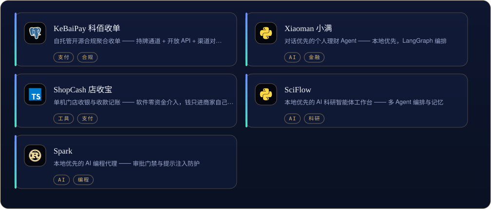

[English](README.md) | [中文](README.zh-CN.md) | [日本語](README.ja.md)

  

<i>夜观星象，以代码作舟。</i>

先解决问题，再写代码。 — John Johnson

<table border="0">
<tr>
<td valign="top" width="58%">

### 关于

长期项目放在这里慢慢打磨：小说引擎、收单系统、P2P 组网。偏工程完整度 —— 文档先于代码，审计先于合并。已有一批补丁合入 ohmyzsh / tldr / icalendar / NUR 等上游项目。

</td>
<td valign="top" width="42%">

### 近期

- 迭代 Novel Engine 的规则一致性审计
- KeBaiPay 渠道对账模块
- 一批上游 PR 在评：ohmyzsh / moto / PDFMathTranslate

</td>
</tr>
</table>

## 工具箱

  

## 精选作品

  

<a href="https://github.com/Morningstar202604/novel-engine">Novel Engine</a> · <a href="https://github.com/Morningstar202604/KeBaiPay">KeBaiPay 科佰收单</a> · <a href="https://github.com/Morningstar202604/p2wlan">p2wlan</a> · <a href="https://github.com/Morningstar202604/xiaoman">Xiaoman 小满</a> · <a href="https://github.com/Morningstar202604/shopcash">ShopCash 店收宝</a> · <a href="https://github.com/Morningstar202604/naiwa-pet">Naiwa 奶蛙</a> · <a href="https://github.com/Morningstar202604/sciflow">SciFlow</a> · <a href="https://github.com/Morningstar202604/spark">Spark</a>

全部公开仓库： [github.com/Morningstar202604](https://github.com/Morningstar202604)

## 数据

  
  

  

## 置顶作品

  
  
  

## 贡献图

  <picture>
    <source media="(prefers-color-scheme: dark)" srcset="./assets/github-contribution-grid-snake-dark.svg" />
    
  </picture>

## 开源足迹

**已合并上游**
- [ohmyzsh/ohmyzsh](https://github.com/ohmyzsh/ohmyzsh) — [#14006](https://github.com/ohmyzsh/ohmyzsh/pull/14006) · [#14021](https://github.com/ohmyzsh/ohmyzsh/pull/14021) · [#14027](https://github.com/ohmyzsh/ohmyzsh/pull/14027) — git locale · pipenv activation · aws stderr
- [tldr-pages/tldr](https://github.com/tldr-pages/tldr) — [#23780](https://github.com/tldr-pages/tldr/pull/23780) — doctl pages
- [collective/icalendar](https://github.com/collective/icalendar) — [#1731](https://github.com/collective/icalendar/pull/1731) · [#1750](https://github.com/collective/icalendar/pull/1750) · [#1751](https://github.com/collective/icalendar/pull/1751) — public exports · deprecations · TYPE_CHECKING
- [nix-community/NUR](https://github.com/nix-community/NUR) — [#1220](https://github.com/nix-community/NUR/pull/1220) — SSL errors treated as transient
- [jaychouchannel/claude-tool-agent](https://github.com/jaychouchannel/claude-tool-agent) — [#30](https://github.com/jaychouchannel/claude-tool-agent/pull/30) · [#31](https://github.com/jaychouchannel/claude-tool-agent/pull/31) · [#33](https://github.com/jaychouchannel/claude-tool-agent/pull/33) · [#34](https://github.com/jaychouchannel/claude-tool-agent/pull/34) · [#35](https://github.com/jaychouchannel/claude-tool-agent/pull/35) — mention parsing · markdown safety
- [Hydrooxzgen/EnderBridge](https://github.com/Hydrooxzgen/EnderBridge) — [#12](https://github.com/Hydrooxzgen/EnderBridge/pull/12) — docs: Message mod
- [deepset-ai/haystack](https://github.com/deepset-ai/haystack) — [#13011](https://github.com/deepset-ai/haystack/pull/13011) — docs: merge_super_component_pipelines

**评审中**
- [ohmyzsh/ohmyzsh](https://github.com/ohmyzsh/ohmyzsh) — [#14140](https://github.com/ohmyzsh/ohmyzsh/pull/14140) · [#14141](https://github.com/ohmyzsh/ohmyzsh/pull/14141) · [#14148](https://github.com/ohmyzsh/ohmyzsh/pull/14148) · [#14149](https://github.com/ohmyzsh/ohmyzsh/pull/14149) — diagnose locale · vi-mode · extract · dirhistory
- [funstory-ai/BabelDOC](https://github.com/funstory-ai/BabelDOC) — [#621](https://github.com/funstory-ai/BabelDOC/pull/621) · [#623](https://github.com/funstory-ai/BabelDOC/pull/623) — translator guards
- [PDFMathTranslate/PDFMathTranslate](https://github.com/PDFMathTranslate/PDFMathTranslate) — [#1202](https://github.com/PDFMathTranslate/PDFMathTranslate/pull/1202) · [#1203](https://github.com/PDFMathTranslate/PDFMathTranslate/pull/1203) · [#1206](https://github.com/PDFMathTranslate/PDFMathTranslate/pull/1206) — qwen-mt · zhipu errors · line splitting
- [getmoto/moto](https://github.com/getmoto/moto) — [#10287](https://github.com/getmoto/moto/pull/10287) — EC2 MaxCount

## 写作

| 日期 | 文章 |
|---|---|
| 2026-10-16 | [MCP 落地一年，我总结了 6 个没人告诉你的工程真相](https://zhuanlan.zhihu.com/p/2094232145015453253) |
| 2026-10-16 | [本地优先 AI：当所有人都在上云，我为什么把 AI 装回自己电脑](https://zhuanlan.zhihu.com/p/2094233605513991576) |
| 2026-10-16 | [AI Agent 上线前必须过的 5 道关：一个真实项目的工程手记](https://zhuanlan.zhihu.com/p/2094218858789856836) |
| 2026-09-27 | [Playwright 多平台分发：8 个踩坑与合规门禁](https://blog.csdn.net/weixin_56622231/article/details/166698802) |
| 2026-09-25 | [AI Agent 智能体开发从零到一：2026年程序员完整学习路线与实战指南](https://blog.csdn.net/weixin_56622231/article/details/166643070) |

同步发布  <a href="https://blog.csdn.net/weixin_56622231">CSDN</a> ·  <a href="https://juejin.cn/user/2350111542479753">Juejin</a> ·  <a href="https://www.zhihu.com/people/e7c851hd">Zhihu</a>

## 在别处

> 同一身份，五处安放 —— 这五个账号同属一人，互为镜像。

| | 平台 | 账号 | 定位 |
|---|---|---|---|
|  | GitHub | **[X33834](https://github.com/X33834)** | 上游开源 · 工具与作品 |
|  | GitHub | **[Morningstar202604](https://github.com/Morningstar202604)** | 作品集 · 长期项目 ◆ *你在这里* |
|  | GitHub | **[badhope](https://github.com/badhope)** | 个人主页 · 全栈工具馆 |
|  | GitCode | **[badhope](https://gitcode.com/badhope)** | 移动端开发 · 离线工具 |
|  | Gitee | **[badhope](https://gitee.com/badhope)** | 作品镜像 · 小程序 |

  

© Morningstar202604

