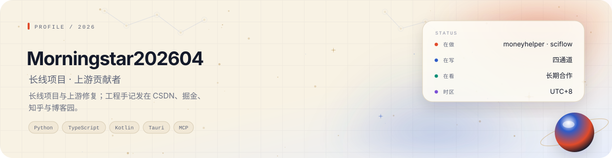
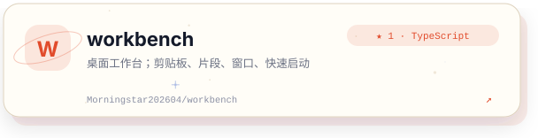
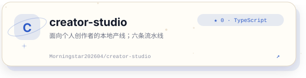
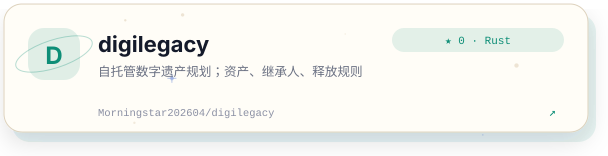
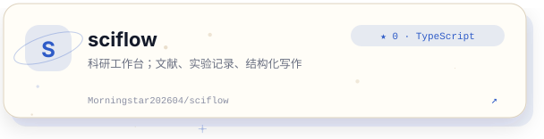
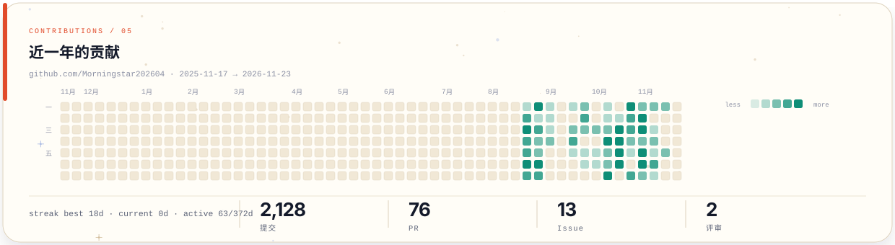
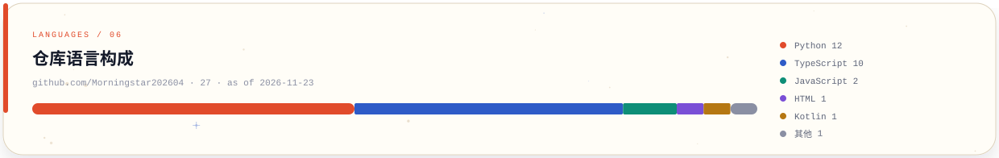

<a href="README.md">English</a> · <b>中文</b> · <a href="README.ja.md">日本語</a>

<picture><source media="(prefers-color-scheme: dark)" srcset="assets/hero-zh-CN-dark.svg" /></picture>

<picture><source media="(prefers-color-scheme: dark)" srcset="assets/starchart-zh-CN-dark.svg" /></picture>

缓慢旋转的星图 · 一圈一分钟

## 01 · 现在

- **个人仓库** — 27 个 · 个人命名空间，不含 fork
- **外部 PR** — 6 条：已合并 5，开放中 1，已关闭 0
- **发布** — CSDN 长文归档；掘金、知乎、博客园自动运营

## 02 · 外部 PR

6 条 · 已合并 5 · 开放中 1 · 已关闭 0 · +282/−38 · 15 个文件 · 34 条评论

已合并 5 条 · 平均 6.4 天 · 最快 1 天

- [ohmyzsh/ohmyzsh#14140](https://github.com/ohmyzsh/ohmyzsh/pull/14140) — feat(core): add `omz diagnose` locale check · **开放中** · 开启于 2026-09-29 · +39/−0 · 2 个文件 · 2 条评论
- [PyCalendar/icalendar#1731](https://github.com/PyCalendar/icalendar/pull/1731) — docs: stop composing single_utc_property docstrings from the property name · **已合并** · 合并于 2026-09-08 · +129/−16 · 4 个文件 · 22 条评论
- [PyCalendar/icalendar#1751](https://github.com/PyCalendar/icalendar/pull/1751) — Refactor TYPE_CHECKING imports to use public exports from icalendar.cal · **已合并** · 合并于 2026-09-03 · +4/−4 · 4 个文件 · 8 条评论
- [ohmyzsh/ohmyzsh#14021](https://github.com/ohmyzsh/ohmyzsh/pull/14021) — fix(pipenv): keep activation and the project directory in sync · **已合并** · 合并于 2026-09-05 · +12/−5 · 1 个文件 · 1 条评论
- [jaychouchannel/claude-tool-agent#34](https://github.com/jaychouchannel/claude-tool-agent/pull/34) — fix(frontend): 星号强调仅限单行配对，* 列表与行内代码不再被误吞 · **已合并** · 合并于 2026-10-11 · +13/−8 · 1 个文件 · 1 条评论
- [jaychouchannel/claude-tool-agent#33](https://github.com/jaychouchannel/claude-tool-agent/pull/33) — fix(orchestrator): 修复回复开头 @ 导致的链式发言断链 · **已合并** · 合并于 2026-08-29 · +85/−5 · 3 个文件 · 0 条评论

PR 快照 2026-11-22 · GitHub Search / pulls API

## 03 · 精选项目

<a href="https://github.com/Morningstar202604/workbench"><picture><source media="(prefers-color-scheme: dark)" srcset="assets/project-0-zh-CN-dark.svg" /></picture></a> <a href="https://github.com/Morningstar202604/creator-studio"><picture><source media="(prefers-color-scheme: dark)" srcset="assets/project-1-zh-CN-dark.svg" /></picture></a>

<a href="https://github.com/Morningstar202604/digilegacy"><picture><source media="(prefers-color-scheme: dark)" srcset="assets/project-2-zh-CN-dark.svg" /></picture></a> <a href="https://github.com/Morningstar202604/harbor"><picture><source media="(prefers-color-scheme: dark)" srcset="assets/project-3-zh-CN-dark.svg" /></picture></a>

<a href="https://github.com/Morningstar202604/moneyhelper"><picture><source media="(prefers-color-scheme: dark)" srcset="assets/project-4-zh-CN-dark.svg" /></picture></a> <a href="https://github.com/Morningstar202604/sciflow"><picture><source media="(prefers-color-scheme: dark)" srcset="assets/project-5-zh-CN-dark.svg" /></picture></a>

更多项目: [world-walker](https://github.com/Morningstar202604/world-walker) · [spark](https://github.com/Morningstar202604/spark)

## 04 · 数据

<picture><source media="(prefers-color-scheme: dark)" srcset="assets/numbers-zh-CN-dark.svg" /></picture>

## 05 · 贡献日历

<picture><source media="(prefers-color-scheme: dark)" srcset="assets/contrib-zh-CN-dark.svg" /></picture>

逐日贡献来自 GitHub GraphQL 精确快照 · 每周刷新

## 06 · 语言构成

<picture><source media="(prefers-color-scheme: dark)" srcset="assets/langs-zh-CN-dark.svg" /></picture>

## 07 · 发布管线

<a href="https://blog.csdn.net/weixin_56622231"><picture><source media="(prefers-color-scheme: dark)" srcset="assets/channel-csdn-zh-CN-dark.svg" /></picture></a> <a href="https://juejin.cn/user/2350111542479753/posts"><picture><source media="(prefers-color-scheme: dark)" srcset="assets/channel-juejin-zh-CN-dark.svg" /></picture></a>

<a href="https://www.zhihu.com/people/e7c851hd"><picture><source media="(prefers-color-scheme: dark)" srcset="assets/channel-zhihu-zh-CN-dark.svg" /></picture></a> <a href="https://www.cnblogs.com/badhope"><picture><source media="(prefers-color-scheme: dark)" srcset="assets/channel-cnblogs-zh-CN-dark.svg" /></picture></a>

四个发布账号：CSDN 手动归档；掘金、知乎、博客园由自动化管线运营。

CSDN 最近

- 2026-11-04 — [把 AI Agent 接进业务系统，我踩了 3 个挺蠢的坑](https://blog.csdn.net/weixin_56622231/article/details/170051167)
- 2026-10-18 — [Gemini 4 Argon 全面开放：谷歌憋了半年的旗舰大招，到底行不行？](https://blog.csdn.net/weixin_56622231/article/details/168251657)

<a href="https://blog.csdn.net/weixin_56622231">CSDN 全部文章 →</a>

One source, five profiles · numbers from a local snapshot

全部仓库: [github.com/Morningstar202604](https://github.com/Morningstar202604)
